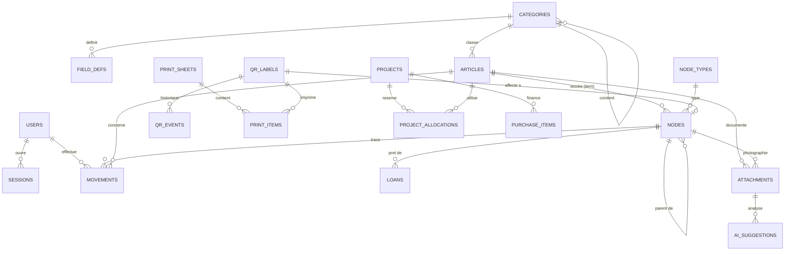

# MyWorkshop : Phase 1, analyse fonctionnelle et conception technique

Statut : **proposition à valider**. Aucun code applicatif n'est généré à ce stade.
Nom provisoire : MyWorkshop. Kept Inventory n'est utilisé ni comme base ni comme dépendance.

---

## 0. Résumé des choix

| Sujet | Choix retenu |
|---|---|
| Backend | Python 3.13 (paquet Debian 13), FastAPI, SQLAlchemy 2, Alembic, Pydantic v2 |
| Base de données | PostgreSQL 17 (paquet Debian 13) (+ pg_trgm pour la recherche floue, pgvector plus tard pour la similarité visuelle) |
| Frontend | React + TypeScript + Vite, PWA (vite-plugin-pwa / Workbox) |
| Stockage hors ligne | IndexedDB via Dexie.js, file d'attente d'opérations (outbox) |
| Hébergement | LXC Debian 13 (trixie) non privilégié sur Proxmox, installation native (systemd : PostgreSQL, API, Caddy) |
| Accès distant | Tailscale (VPN maillé), aucun port ouvert sur Internet |
| QR codes | Série unique `QR-000001…`, génération avec `segno`, PDF avec ReportLab |
| IA | Module `ai/` isolé derrière des interfaces (Protocol), fournisseur configurable |
| Modèle de stock | Mouvements append-only + quantité recalculée, pour éviter la plupart des conflits |

---

## 1. Cahier des charges fonctionnel (synthèse)

### 1.1 Périmètre fonctionnel

- **Inventaire** : articles (familles de référence) et stocks physiques (nœuds `item`) situés dans l'arborescence.
- **Emplacements** : arborescence libre, types d'emplacements définis par l'utilisateur, aucune profondeur maximale.
- **Étiquettes QR** : une seule série universelle, cycle de vie traçé, gestionnaire d'impression.
- **Identification** : photo, OCR et IA facultatifs, mode manuel complet.
- **Recherche** : texte, filtres, emplacement, similarité visuelle (phase 4).
- **Projets, prêts, consommations, liste d'achats, documents, tableau de bord** : phases 2 à 5.

### 1.2 Exigences non fonctionnelles

- Usage quotidien rapide : scan → action en 2 à 3 écrans maximum.
- Données uniquement sur le serveur local, sauvegardes automatiques, aucun abonnement obligatoire.
- Plusieurs appareils simultanés, synchronisation sans perte de données.
- Fonctionnement hors ligne : consultation et saisie avec mise en file d'attente.
- Distinction explicite entre « pas d'Internet » et « serveur local injoignable ».

### 1.3 Périmètre MVP (fin de phase 3)

Authentification, catégories et champs personnalisés, articles, emplacements et contenants, stocks, photos, recherche simple, étiquettes QR (génération, impression, affectation, déplacement par scan), historique.

---

## 2. Architecture technique

```
 Android / PC / tablette                         Proxmox (LXC Debian 13)
 ┌──────────────────────────┐   HTTPS (LAN     ┌──────────────────────────────────┐
 │ PWA React (cache SW)     │   ou Tailscale)  │ Caddy : TLS, fichiers statiques  │
 │  - UI                    │ ───────────────▶ │   /        → PWA (build)         │
 │  - IndexedDB (Dexie)     │                  │   /api/*   → FastAPI             │
 │  - Outbox + sync         │ ◀─────────────── │ FastAPI (uvicorn)                │
 │  - Scanner QR (caméra)   │                  │   domaines, services, sync, ia/  │
 └──────────────────────────┘                  │ PostgreSQL 17                    │
                                               │ /data/files  (photos, documents) │
                                               │ /data/backups (pg_dump, rotation)│
                                               └──────────────────────────────────┘
```

Règles de base :

- **Une seule application backend** (monolithe modulaire). Pas de microservices : le volume est celui d'un inventaire personnel.
- La logique métier est dans `services/` ; les routes HTTP et les accès SQL ne contiennent pas de règles.
- Le module IA n'est appelé que par des services, jamais par les routes ou les modèles.
- Le frontend consomme une couche d'accès aux données unique (`data/`) qui hésite entre appel réseau direct (phases 2 à 4) et lecture/écriture via IndexedDB + outbox (phase 5). Prévoir cette couche dès la phase 2 évite une réécriture.

---

## 3. Choix technologiques

| Besoin | Retenu | Alternatives évaluées | Raison |
|---|---|---|---|
| API | FastAPI | Django, Flask | Typage, OpenAPI généré, rapide à écrire, bon écosystème vision/IA en Python |
| ORM / migrations | SQLAlchemy 2 + Alembic | SQLModel, Django ORM | Contrôle SQL, migrations standard |
| Frontend | React + TS + Vite | Vue, Svelte | Écosystème PWA et bibliothèques de scan mature |
| UI | Tailwind + composants shadcn/ui | Mantine, MUI | Léger, personnalisable, mobile-first facile |
| PWA hors ligne | vite-plugin-pwa + Dexie | RxDB, PouchDB | Dexie simple, IndexedDB explicite, pas de moteur de sync tiers à maintenir |
| Scan QR | API `BarcodeDetector` si disponible, sinon bibliothèque JS (zxing-wasm) | html5-qrcode | Natif sur Chrome Android, repli fiable |
| Génération QR | `segno` (Python) | `qrcode` | Sortie SVG propre, précise en mm |
| PDF planches | ReportLab | WeasyPrint | Positionnement au millimètre, adapté aux planches d'étiquettes |
| Hachage mots de passe | argon2-cffi (Argon2id) | bcrypt | Recommandation actuelle |
| Reverse proxy | Caddy | Nginx, Traefik | TLS automatique, configuration courte |
| Recherche | PostgreSQL (tsvector français + pg_trgm) | Meilisearch, Elasticsearch | Un service de moins, suffisant à cette échelle |

Ce qui n'est **pas** ajouté : Redis, file de messages, Kubernetes, microservices, second moteur de recherche.

---

## 4. Infrastructure Proxmox et déploiement

### 4.1 Hôte

- **Un conteneur LXC Debian 13 (trixie) non privilégié** (`myworkshop`), 2 vCPU, 2 Go RAM, disque 16 Go + volume de données dédié (photos et sauvegardes, à dimensionner). Aucun nesting requis.
- Une VM n'est pas justifiée : pas de matériel spécifique, pas d'isolation de sécurité requise au-delà du LXC.

### 4.2 Services (installation native, systemd)

| Service | Installation | Rôle | Exposition |
|---|---|---|---|
| `caddy` | paquet Debian | TLS, PWA statique, proxy `/api` | 443 (LAN et Tailscale uniquement) |
| `myworkshop-api` | virtualenv Python 3.13 dans `/opt/myworkshop`, uvicorn sous systemd | FastAPI | 127.0.0.1 uniquement, derrière Caddy |
| `postgresql` | paquet Debian 17 | Base de données | 127.0.0.1 uniquement, jamais publié |

Chaque service tourne sous un utilisateur système dédié. Mise à jour : `git pull`, `alembic upgrade head`, redémarrage de `myworkshop-api`.

Pas de service IA séparé en phase 1 : il s'intégrera dans `api`. Un worker séparé ne sera ajouté que si un traitement long (embeddings) le justifie.

### 4.3 HTTPS sur le LAN (point critique)

L'API caméra (`getUserMedia`) et l'installation PWA exigent un **contexte sécurisé** (HTTPS). Un accès `http://192.168.x.x` ne permettra pas de scanner. Options :

1. **Recommandé si vous possédez un nom de domaine** : sous-domaine dédié (ex. `workshop.mondomaine.fr`) pointant vers l'IP LAN, certificat Let's Encrypt via challenge DNS (plugin Caddy selon votre registrar). Aucun port ouvert nécessaire.
2. **Sans domaine** : autorité de certification locale (Caddy `tls internal` ou step-ca), à installer comme certificat racine sur chaque appareil Android et PC.
3. **Accès distant** : Tailscale avec `tailscale cert` (certificat pour le nom MagicDNS).

### 4.4 Sauvegardes (compatibles Proxmox)

- **Quotidien** : `pg_dump -Fc` vers `/data/backups/db/`, rotation 14 jours et 8 semaines.
- **Quotidien** : copie incrémentale de `/data/files` (rsync ou restic).
- **Hebdomadaire** : sauvegarde Proxmox `vzdump` du conteneur (snapshot-mode), conservation 4 versions.
- **Copie hors machine** : une copie vers un autre support (NAS, disque USB, stockage distant chiffré). Règle 3-2-1 recommandée.
- **Restauration** : procédure écrite et **testée** au moins une fois par trimestre sur un second conteneur de test.

---

## 5. Modèle de données

### 5.1 Principes

1. **Identifiants UUID générés côté client** : permettent de créer des objets hors ligne sans collision.
2. **Une seule table `nodes` pour tout ce qui est physique** (emplacement, contenant, objet/lot). Le déplacement d'un parent ne touche jamais ses enfants.
3. **Stock = mouvements** : chaque variation de quantité est une ligne dans `movements`. La quantité courante est une valeur dénormalisée, vérifiable par la somme des mouvements.
4. **Versionnage optimiste** sur les entités modifiables (`version` entier, incrémenté à chaque écriture).
5. **Suppression logique** (`archived_at`). Aucune suppression silencieuse d'un mouvement.
6. **Journal de synchronisation** (`change_log`, séquence `seq` croissante) et table `applied_ops` pour l'idempotence.

### 5.2 Tables principales

| Table | Contenu clé |
|---|---|
| `users`, `sessions`, `devices` | Comptes, rôles (`admin`, `membre`, `lecture`), sessions, appareils enregistrés |
| `categories` | Arborescence (`parent_id`) |
| `field_defs` | Champs personnalisés par catégorie : clé, libellé, type (`text`, `number`, `enum`, `bool`, `unit`), unité, options, obligatoire |
| `articles` | Nom, catégorie, marque, référence fabricant, description, mots-clés, `attributes` JSONB validé par `field_defs`, `min_quantity` (alerte stock faible), `version`, `archived_at` |
| `node_types` | Types d'emplacements et de contenants définis par l'utilisateur (« Meuble », « Tiroir », « Boîte », « Compartiment »…) |
| `nodes` | `kind` ∈ {`location`, `container`, `item`}, `parent_id`, `node_type_id`, `name`, pour `item` : `article_id`, `quantity` (numeric 12,3), `unit`, `version`, `archived_at` |
| `qr_labels` | `code` (PK, ex. `QR-000001`), `seq` (unique), `status` ∈ {`available`, `assigned`, `disabled`}, `assigned_node_id` (unique), `reserved_device_id`, `printed_at`, `print_count` |
| `qr_events` | Historique : créée, imprimée, affectée, désaffectée, désactivée, remplacée, réimprimée |
| `print_sheets`, `print_items` | Planche (numéro, configuration JSON, réimpression oui/non), position 1 à 65, code, `is_reprint` |
| `movements` | `op_id` (unique), `node_id`, `article_id`, `delta`, `kind` (`in`, `out`, `consume`, `move`, `split`, `adjust`, `loan`, `return`, `project_use`), `from_node_id`, `to_node_id`, `project_id`, `reason`, `actor_id`, `device_id`, `at` |
| `projects` | Nom, statut, description, notes |
| `project_allocations` | `project_id`, `article_id`, `reserved_qty` (réservé = quantité prévue ; utilisé = mouvements `project_use` ; restant = réservé − utilisé) |
| `loans` | Matériel prêté (`node_id` de l'élément), destinataire, quantité, `out_at`, `due_at`, `returned_at`, statut |
| `purchase_items` | Libellé, `article_id` facultatif, quantité, lien fournisseur, prix indicatif, `project_id`, statut (`to_buy`, `ordered`, `received`, `cancelled`), `received_node_id` |
| `attachments` | `kind` ∈ {`photo`, `datasheet`, `document`, `link`, `note`}, `article_id` ou `node_id`, `storage_key`, `mime`, `size`, `sha256`, `title`, `url`, `ocr_text` |
| `ai_suggestions` | Résultat brut d'un fournisseur IA, statut `pending`/`accepted`/`rejected` |
| `change_log` | `seq` (bigserial), `entity`, `entity_id`, `version`, `op`, `at` |
| `applied_ops` | `op_id` (PK), `result`, `applied_at` (idempotence des envois hors ligne) |
| `audit_log` | `entity`, `entity_id`, `actor_id`, `action`, `before` JSONB, `after` JSONB, `at` |

### 5.3 Diagramme relationnel



### 5.4 Règles d'intégrité

- **Unicité** : `qr_labels.code`, `qr_labels.seq`, `qr_labels.assigned_node_id`, `movements.op_id`.
- **Pas de cycle** : un nœud ne peut pas devenir descendant de lui-même (vérifié dans le service, puis par un trigger en filet de sécurité).
- **Quantité** : `quantity >= 0` (CHECK). Une opération qui rendrait le stock négatif est rejetée (voir §7.4).
- **Stock total** d'un article = somme des `quantity` des nœuds `item` actifs liés à l'article. Une requête de contrôle vérifie que `quantity` = somme des `delta` pour chaque nœud.
- **Breadcrumb** : requête `WITH RECURSIVE` sur `parent_id`. Un index sur `parent_id` suffit à cette échelle ; aucune colonne de chemin matérialisé en phase 2.
- **Historique** : toute modification d'un nœud ou d'un article écrit une entrée `audit_log` (avant/après).

### 5.5 Opérations clés sur le modèle

- **Déplacer un contenant** : `UPDATE nodes SET parent_id = …, version = version + 1`. Les enfants suivent automatiquement. Un mouvement `move` est enregistré.
- **Sortir une partie d'un lot** (ex. 2 résistances sur 100) : `split` = nouveau nœud `item` avec la quantité prélevée + mouvement négatif sur le nœud d'origine, dans une seule transaction.
- **Prêt** : le lot (ou une partie scindée) est déplacé dans un nœud de type conteneur « Prêt – <destinataire> » lui-même placé dans l'emplacement système « Prêts ». Le stock total reste juste, la disponibilité exclut le nœud « Prêts ».
- **Consommation** : mouvement `consume` négatif, avec `project_id` facultatif.

---

## 6. Système QR universel

### 6.1 Format et cycle de vie

- Identifiant lisible : `QR-000001` (6 chiffres, séquence `seq`).
- Contenu encodé : URL `https://<hôte>/l/QR-000001`. Ainsi, un simple appareil photo ouvre l'application, même hors du scanner intégré.
- États : `available` → `assigned` → (`disabled`). Un retour à `available` n'est jamais automatique ; il exige une action explicite et une confirmation.
- Remplacement d'une étiquette abîmée : l'ancienne passe à `disabled` (événement « remplacée »), la nouvelle est affectée au même nœud. L'historique des deux reste visible.
- Une étiquette `assigned` ne peut être affectée à un autre nœud que par désaffectation explicite.

### 6.2 Résolution d'un scan

`GET /api/v1/qr/{code}` renvoie l'un de trois cas :
- `assigned` → type du nœud et route vers sa fiche ;
- `available` → écran « Affecter cette étiquette » ;
- `disabled` → avertissement avec l'historique.

### 6.3 Procédures

- **Affectation d'un nouvel objet** : scanner l'emplacement (il est mémorisé pour la session de saisie) → photo facultative → IA facultative → saisie minimale → scanner une étiquette vierge → validation.
- **Création d'un emplacement** : scanner le parent → créer → nom → scanner une étiquette vierge.
- **Déplacement** : scanner la source → scanner la destination → confirmer. Le mouvement est écrit dans l'historique.

### 6.4 Gestionnaire d'impression

- **Génération** : planche A4, 5 colonnes × 13 lignes = 65 étiquettes. Valeurs initiales : pas horizontal 42 mm, pas vertical 22,85 mm, marges et espacements paramétrables. Le format réel des planches achetées (ex. type 38,1 × 21,2 mm) doit être **calibré** par une planche d'essai ; les valeurs par défaut ne sont pas garanties.
- **Contenu** : QR code + numéro lisible sous le code.
- **Séquence** : une nouvelle planche prend les `available` dans l'ordre de `seq`. Les `seq` déjà imprimés ne sont jamais repris automatiquement.
- **Protection contre les doublons** :
  1. Avant génération, contrôle des `printed_at` de chaque code de la planche.
  2. Si un code a déjà été imprimé : **avertissement explicite** avec la liste, et refus de générer tant que la case « je confirme la réimpression » n'est pas cochée.
  3. Une réimpression est marquée `is_reprint` et référence la planche d'origine.
  4. Contrainte base : un code ne peut être `available` et imprimé dans deux planches sans événement `reprinted`.
- **Enregistrement** : numéro de planche, date, position, code, statut, nombre d'impressions.

---

## 7. Hors ligne et synchronisation

### 7.1 Trois états distincts affichés en permanence

| État | Détection | Comportement |
|---|---|---|
| En ligne | `GET /api/v1/health` répond | Synchronisation normale |
| Serveur injoignable | Internet présent mais serveur (LAN/VPN) KO | Lectures depuis IndexedDB, écritures en file d'attente |
| Hors ligne | Pas de réseau (`navigator.onLine` = false) | Idem, sans tentative de synchronisation |

Le test réel est la réponse de `/health`, pas `navigator.onLine`, qui est peu fiable.

### 7.2 Cache et base locale

- **Shell de l'application** : Workbox (précache des fichiers de build).
- **Données** : IndexedDB (Dexie) avec une copie des articles, nœuds, catégories, types et étiquettes proches.
- **Photos en attente** : Blob dans IndexedDB, compressées (max 1600 px, JPEG ~300-500 Ko) avant envoi.
- **Stockage persistant** : `navigator.storage.persist()` demandé ; avertissement si le quota est atteint.
- **Plages d'étiquettes pour usage hors ligne** : le serveur réserve N étiquettes disponibles à un appareil (`reserved_device_id`). Elles sont utilisables hors ligne et libérées au retour de la synchronisation si non utilisées.

### 7.3 Protocole

- **Pull** : `GET /api/v1/sync/pull?cursor=<seq>` renvoie les changements (`seq`, entité, id, `version`, données ou suppression) et un nouveau curseur. Snapshot initial : `GET /api/v1/sync/snapshot`.
- **Push** : `POST /api/v1/sync/push` avec un lot d'opérations `{op_id, type, entity, id, base_version, payload, created_at}`. Pour chacune, le serveur répond `applied`, `duplicate`, `conflict` ou `rejected`, avec la version serveur et un message.
- **Idempotence** : `op_id` enregistré dans `applied_ops` ; un envoi répété renvoie `duplicate` sans rejouer.
- **Ordre** : les opérations d'une même entité sont envoyées dans l'ordre de création. Les mouvements sont indépendants.
- **Déclenchement** : au retour du réseau, à l'ouverture de l'application, toutes les 60 s quand la page est visible, et via Background Sync lorsque le navigateur le permet (Android oui, iOS non).
- **Temps réel entre appareils** : flux SSE léger signalant « changement disponible », suivi d'un pull. Pas de WebSocket.

### 7.4 Gestion des conflits (sans perte)

| Type d'opération | Règle | Conflit possible |
|---|---|---|
| Mouvement de stock | Ajout d'un delta, commutatif | Seulement si le stock deviendrait négatif → `rejected` |
| Modification de champs (article, nœud) | `base_version` doit égaler la version serveur | `conflict` : le client garde ses valeurs et les deux versions sont présentées |
| Déplacement | Version + contrôle de cycle | `conflict` ou `rejected` si cycle |
| Affectation d'étiquette | Contrainte d'unicité | `rejected` : « étiquette déjà affectée à … » |
| Suppression | Suppression logique, version | `conflict` si modifié entre-temps |
| Photo | Upload idempotent par UUID client | Aucun |

Résolution : une file « Conflits et erreurs » dans l'application. Pour chaque élément : garder le mien, garder celui du serveur, ou fusionner champ par champ. **Aucune valeur n'est écrasée sans être conservée dans `audit_log`.**

Pour le MVP de la synchronisation, la fusion champ par champ n'est pas nécessaire : le choix « garder l'un ou l'autre » suffit.

### 7.5 Où implémenter

Les colonnes `version`, `op_id` et `change_log` sont prévues **dès la phase 2**, même si la synchronisation hors ligne n'est livrée qu'en phase 5. Ajouter ces colonnes après coup serait coûteux.

---

## 8. Intelligence artificielle

### 8.1 Architecture

```
services/identification.py ──▶ ai/base.py (Protocol)
                                 ├── ai/providers/local_ocr.py       (Tesseract)
                                 ├── ai/providers/local_embed.py     (CLIP / SigLIP, plus tard)
                                 └── ai/providers/remote_*.py        (API gratuite configurable)
```

- Interfaces : `identify(image) -> list[Suggestion]`, `ocr(image) -> str`, `embed(image) -> vector`.
- Le fournisseur est choisi dans la configuration. Aucune logique métier n'importe un fournisseur précis.
- Toute suggestion est stockée dans `ai_suggestions` en `pending` et doit être **validée** par l'utilisateur avant d'alimenter un article.

### 8.2 Les cinq fonctions

| Fonction | Approche prévue | Phase |
|---|---|---|
| 1. Identification d'objets | Fournisseur multimodal (API gratuite configurable) ou modèle local | 4 |
| 2. OCR des inscriptions | Tesseract (local, gratuit), prétraitement d'image (contraste, redressement) | 4 |
| 3. Composants électroniques | OCR des marquages + normalisation de référence (ex. `LM317T`), recherche dans les articles existants, lien vers la datasheet | 4 |
| 4. Composants similaires | Embeddings visuels (CLIP / SigLIP local) stockés dans pgvector | 4 |
| 5. Recherche d'un objet par photo | Même embedding, recherche des plus proches voisins dans l'inventaire | 4 |

### 8.3 Contraintes

- Hébergement CPU uniquement (LXC sans GPU) : les modèles locaux doivent être petits ; les embeddings sont calculés une fois à l'ajout puis conservés.
- **Envoi de photos vers un service externe : opt-in, désactivé par défaut**, avec mention dans les paramètres.
- Quotas des API gratuites : à documenter au moment de l'intégration, car ils changent. Le système doit tolérer une panne ou un quota dépassé et retomber en mode manuel.

---

## 9. Sécurité

- **Authentification** : mots de passe hachés en Argon2id ; sessions côté serveur dans un cookie `HttpOnly`, `Secure`, `SameSite=Lax`, durée et rotation configurables.
- **Protection CSRF** : en-tête personnalisé exigé sur les écritures + SameSite.
- **Rôles** : `admin` (utilisateurs, sauvegardes, configuration), `membre` (lecture et écriture), `lecture` (consultation seulement).
- **Validation** : Pydantic sur toutes les entrées ; taille et type MIME vérifiés sur les fichiers ; EXIF supprimé des photos (géolocalisation).
- **Fichiers** : stockés sous un nom UUID hors de tout chemin fourni par l'utilisateur ; servis uniquement via l'API avec contrôle d'accès.
- **Réseau** : seuls 443 (Caddy) est accessible ; PostgreSQL n'est jamais publié. Accès distant via Tailscale uniquement.
- **Journal** : `audit_log` pour les modifications importantes, connexions échouées incluses.
- **Secrets** : fichier `.env` hors dépôt Git, permissions restreintes.
- **Mises à jour** : dépendances Python épinglées dans un fichier de verrouillage ; paquets Debian mis à jour avec `apt` (correctifs de sécurité inclus) ; procédure documentée.

---

## 10. API (aperçu, préfixe `/api/v1`)

| Ressource | Routes principales |
|---|---|
| Auth | `POST /auth/login`, `POST /auth/logout`, `GET /auth/me` |
| Catégories | `GET/POST /categories`, `GET/POST /categories/{id}/fields` |
| Articles | `GET /articles?q=&category=&…`, `POST`, `GET/PATCH /articles/{id}`, `DELETE` (archive) |
| Nœuds | `GET /nodes/tree`, `GET /nodes/{id}/children`, `GET /nodes/{id}/breadcrumb`, `POST`, `PATCH` (déplacement avec `version`), `POST /nodes/{id}/split`, `DELETE` (archive) |
| Stock | `POST /movements`, `GET /movements?node_id=&article_id=` |
| QR | `GET /qr/{code}`, `GET /qr/stats`, `POST /qr/reserve`, `POST /qr/{code}/assign`, `…/unassign`, `…/disable`, `…/replace` |
| Impression | `POST /print/sheets/preview` (avertissements de doublons), `POST /print/sheets`, `GET /print/sheets`, `GET /print/sheets/{id}/pdf` |
| Projets | `GET/POST /projects`, `GET/PATCH /projects/{id}`, `POST /projects/{id}/allocations` |
| Prêts | `POST /loans`, `POST /loans/{id}/return` |
| Achats | `GET/POST /purchases`, `POST /purchases/{id}/receive` |
| Fichiers | `PUT /attachments/{client_uuid}` (idempotent), `GET /attachments/{id}`, `GET /attachments/{id}/thumb` |
| Recherche | `GET /search?q=&filters…` ; `POST /search/by-image` (phase 4) |
| Tableau de bord | `GET /dashboard` |
| IA | `POST /ai/identify`, `POST /ai/ocr` (suggestions, jamais d'écriture directe) |
| Synchronisation | `GET /sync/snapshot`, `GET /sync/pull`, `POST /sync/push`, `GET /events` (SSE) |
| Système | `GET /health`, `GET /admin/backups` |

Toutes les écritures acceptent un `op_id` facultatif (obligatoire en mode synchronisation).

---

## 11. Organisation du dépôt (monorepo)

```
myworkshop/
├── backend/
│   ├── app/
│   │   ├── api/          routes HTTP (fines)
│   │   ├── services/     règles métier
│   │   ├── models/       SQLAlchemy
│   │   ├── schemas/      Pydantic
│   │   ├── qr/           génération, séquence, résolution
│   │   ├── printing/     planches PDF
│   │   ├── sync/         pull, push, conflits
│   │   ├── ai/           interfaces et fournisseurs
│   │   └── core/         config, sécurité, base, journal
│   ├── migrations/       Alembic
│   └── tests/
├── frontend/
│   ├── src/
│   │   ├── screens/      les 13 écrans
│   │   ├── features/     scan, ajout, recherche…
│   │   ├── data/         accès API + IndexedDB + outbox
│   │   └── components/
│   └── public/
├── deploy/
│   ├── systemd/          unités myworkshop-api et sauvegardes
│   ├── caddy/Caddyfile
│   ├── backup/           scripts pg_dump, rotation, restauration
│   └── proxmox/          notes de création du LXC
└── docs/                 architecture, ADR, guide utilisateur, API
```

Les décisions structurantes seront consignées dans `docs/adr/` (une note par décision).

---

## 12. Interfaces (aperçu)

Les 13 écrans demandés sont regroupés en navigation basse (mobile) : **Accueil, Rechercher, Scanner, Ajouter** en barre principale ; **Inventaire, Emplacements, Projets, Plus** (Catégories, Achats, Documents, Gestionnaire QR, Paramètres) en secondaire.

Écran d'accueil (smartphone) :

```
┌──────────────────────────────┐
│ MyWorkshop        ● En ligne │
├──────────────────────────────┤
│ [ Scanner ]   [ Ajouter ]    │
│ [ Rechercher ] [ Emplacements]│
├──────────────────────────────┤
│ Stocks faibles        (3)  ›│
│ Non localisés         (1)  ›│
│ Étiquettes libres     42    │
│ Derniers ajouts             │
│  · ESP32-C3 SuperMini   ×4   │
│  · Filament PLA noir  820 g  │
└──────────────────────────────┘
```

Scénario « Affecter une étiquette » :

```
Scanner l'emplacement  →  Tiroir 4 / Boîte composants  (mémorisé)
Photographier l'objet  →  [ Identifier (IA) ]  ou  [ Saisie manuelle ]
Champs minimum         →  Nom · Quantité · Catégorie
Scanner une étiquette  →  QR-000123 (disponible)
[ Valider ]            →  Objet enregistré et localisé
```

Les maquettes graphiques détaillées (captures visuelles) seront produites en phase 1 bis, après validation de ce document.

---

## 13. Tests et qualité

- **Backend** : pytest. Tests de service (règles de quantité, cycle de déplacement, séquence QR, protection des doublons d'impression) et tests d'API avec une base PostgreSQL réelle (instance PostgreSQL de test, pas de SQLite).
- **Migrations** : Alembic testé en montée et descente sur base vide et base de test.
- **Frontend** : Vitest + Testing Library pour les composants ; Playwright en émulation mobile pour les parcours scan → affectation → déplacement.
- **Synchronisation** : simulations de deux clients hors ligne modifiant la même entité, puis reconnexion. Vérifier l'absence de perte et la bonne détection de conflit.
- **Qualité** : ruff (lint et format), mypy sur `services/` et `sync/`, ESLint + TypeScript strict.
- **Restauration** : test trimestriel de restauration complète sur un conteneur de test.

---

## 14. Risques techniques

| Risque | Impact | Mitigation |
|---|---|---|
| Caméra inaccessible en HTTP sur le LAN | Scan impossible | HTTPS dès le départ (§4.3) |
| Complexité de la synchronisation | Bugs, perte de données | Mouvements append-only, versions, `op_id`, pas de fusion champ par champ au MVP, tests de concurrence |
| Quota de stockage du navigateur (IndexedDB) | Photos hors ligne refusées | Compression, `persist()`, purge des photos déjà envoyées |
| Alignement des planches d'étiquettes | Étiquettes décalées | Planche d'essai, paramètres de marge enregistrés |
| Qualité de l'IA | Mauvaises suggestions | Validation obligatoire, mode manuel complet, aucune écriture directe |
| Quotas des API gratuites | Fonction indisponible | Fournisseurs interchangeables, dégradation vers le manuel |
| Périmètre trop large | Projet qui ne se termine pas | MVP défini (§1.3), phases strictes |
| Sauvegardes non restaurables | Perte définitive | Test de restauration trimestriel |
| Étiquettes qui se décollent ou s'abîment en atelier (solvants, chaleur, poussière) | Scan impossible | Étiquettes vinyle ou résistantes ; procédure de remplacement (§6.1) |
| Stockage iOS limité | Non prioritaire (Android ciblé) | À évaluer si un iPhone est utilisé |

---

## 15. Points à arbitrer

1. **HTTPS** : *décidé* : `daniel.ldns.fr` (domaine familial chez OVH), pointant vers l'IP locale, certificat Let's Encrypt par challenge DNS (certbot + API OVH limitée à la zone). Voir `docs/installation.md` §6.
2. **Hébergement** : *décidé* : installation native sous Debian 13 (§4.2).
3. **Utilisateurs** : un seul compte administrateur, ou plusieurs personnes (famille) avec des rôles ?
4. **Planches d'étiquettes** : référence exacte de la planche achetée (dimensions de l'étiquette et marges) pour la calibration.
5. **IA** : acceptez-vous l'envoi de photos vers un service externe gratuit (opt-in) ou souhaitez-vous rester 100 % local, quitte à être moins précis ?
6. **Données existantes** : avez-vous un export (CSV, tableur, notes) de votre inventaire actuel à importer ?
7. **Stock négatif** : interdit (proposé) ou autorisé avec alerte ?
8. **Synchronisation** : faut-il la livrer avant la phase QR (utile si le réseau est faible dans l'atelier) ou après (proposé) ?
9. **Langue** : français uniquement au départ (proposé), ou interface multilingue prévue ?

---

## 16. Plan de phases (ajusté)

| Phase | Contenu | Sortie attendue |
|---|---|---|
| 1 | Conception (ce document), maquettes visuelles | Validation par l'utilisateur |
| 2 | Socle : dépôt, auth, catégories, articles, nœuds, stock, photos, recherche simple, déploiement LXC + HTTPS | Inventaire utilisable en ligne |
| 3 | QR : séquence, impression, protection des doublons, affectation, déplacement par scan | Étiquettes réelles collées |
| 3 bis | Hors ligne et synchronisation (si validé au point 8) | Usage en atelier sans réseau |
| 4 | IA : OCR, identification, embeddings, recherche par photo | Identification assistée validée |
| 5 | Projets, prêts, consommations, achats, documents, accès distant | Fonctions avancées |

Phase 2 : sauvegardes automatisées et procédure de restauration livrées avant toute donnée réelle importante.
